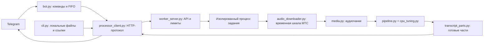

# Анализ и рефакторинг проекта

Дата: 12 ноября 2026 года. Проверены все исходные модули, тесты, Docker/Compose, примеры настроек и установочный скрипт. Анализ выполнен по исходникам и локальным интеграционным проверкам. Доступ к рабочему серверу, приватным записям МТС Линк и измерениям реального Whisper в этой работе не использовался.

## Архитектура после изменений



| Модуль | Ответственность |
|---|---|
| `common.py` | URL записей, форматы, параметры распознавания, общий тип отмены; не импортирует воркер |
| `bot.py` | Telegram, очередь пользователя, доставка результата, политика сообщений об ошибках |
| `cli.py` | Удалённая расшифровка из терминала: потоковая отправка больших файлов, прогресс, отмена и сохранение `.txt` |
| `processor_client.py` | Отправка задания, опрос, дедлайн, отмена, потоковое получение и атомарная публикация результата |
| `worker_server.py` | Авторизация API, приём файлов, ограничение очереди, жизненный цикл процессов и очистка |
| `process_control.py` | Создание отдельной сессии задания и остановка группы процессов |
| `pipeline.py` | Координация загрузки, модели, нарезки, параллельного распознавания и статуса |
| `media.py` | Нарезка PCM WAV напрямую; FFmpeg для остальных входных форматов |
| `transcript_parts.py` | Атомарное завершение частей и восстановление частичного текста |
| `audio_downloader.py` | Загрузка МТС Линк с общим пулом соединений, микширование по `relativeTime` |
| `cpu_tuning.py` | Изолированные измерения конфигураций CPU и кэш выбранного варианта |
| `mts_fallback.py` | Изолированный запуск резервного загрузчика MoviePy/mtslinker |
| `transcribe.py` | CLI с общими настройками модели, языка и форматирования времени |

## Исправленные узкие места и дефекты

P1 — потеря задания/результата или неправильное управление ресурсами. P2 — задержки, лишняя работа, недостаточная изоляция.

| Приоритет | Было | Изменение и практический результат |
|---|---|---|
| P1 | Второе задание регистрировалось в очереди, но обработчик возвращался до создания исполняющего потока | FIFO с `Condition`: поток ждёт свой слот, завершение или отмена предыдущего задания будит ожидающих |
| P1 | Удаление/освобождение ожидающего задания могло уменьшать общий счётчик активных заданий | Слот учитывается отдельно у каждого задания; повторное освобождение и отмена очереди не освобождают чужой слот |
| P1 | Текст параллельных частей объединялся только после полного завершения | Части публикуются атомарно, хранятся независимо; хронологический готовый префикс виден во время работы, после отмены собираются все завершённые части |
| P1 | Повторная ссылка использовала то же имя результата; отмена могла подобрать старый текст | Реальные задания бота получают уникальные пути; старый результат не используется как частичный, скачивание идёт через временный файл |
| P1 | `terminate()` останавливала процесс Python, но не гарантировала остановку FFmpeg | Задание создаёт отдельную сессию; отмена/таймаут останавливают всю группу. Добавлен тест с настоящими spawned-процессами |
| P1 | Оборванный upload оставлял каталог и частичный исходник | Файл и запись задания удаляются; приём имеет socket timeout, размер и ёмкость очереди проверяются до обработки |
| P1 | Одновременные задания каждое рассчитывали ресурсы на весь сервер | CPU и доступная RAM делятся на настроенную вместимость воркера; учитывается мягкий предел `memory.high` |
| P2 | Для каждого аудиочанка запускался отдельный FFmpeg даже после нормализации МТС в PCM WAV | Готовый mono PCM16/16 kHz WAV режется по сэмплам средствами `wave`; не запускаются лишние процессы и декодеры |
| P2 | Отдельный HTTP-клиент для каждого HEAD/GET, последовательное скачивание медиафрагментов | Общий пул до 10 соединений, до 4 одновременных скачиваний, конечный таймаут чтения, streamed GET при неподдерживаемом HEAD |
| P2 | Socket timeout мог равняться многочасовому времени расшифровки | Короткие connect/read/write таймауты отдельно от дедлайна; дедлайн начинается до отправки и проверяется между запросами и блоками передачи |
| P2 | Ошибка DELETE при истечении дедлайна могла скрыть исходный таймаут | Неудачная отмена логируется, наружу возвращается исходный deadline error |
| P2 | Отправка результата в Telegram удерживала слот обработки | Следующая расшифровка может начаться, пока предыдущий текст доставляется в чат |
| P2 | Отложенное обновление прогресса могло прийти после финального сообщения | Обновлятор закрывается перед доставкой; ожидающие обновления отменяются |
| P2 | Резервный загрузчик менял глобальный cwd и выбирал самый большой MP4, которым мог быть исходный фрагмент | Отдельный процесс со своим cwd; выбирается итоговый render `<name>/<name>.mp4`, а не произвольный крупный файл |
| P2 | Очередь и число ожидающих потоков не имели ограничения | Настраиваемые пределы очередей бота/воркера; HTTP 429 при переполнении API |
| P2 | Очистка происходила только при новых заданиях, срок считался с момента создания | Периодическая очистка раз в минуту, TTL от завершения, рабочие файлы находятся внутри каталога задания |
| P2 | Одинаковый код запуска/доставки для ссылок и файлов, HTTP-протокол внутри Telegram-модуля | Единый исполнитель заданий и отдельный клиент протокола; общие параметры CLI/воркера, меньше связанных веток отмены и очистки |
| P2 | Стандартные HTTPX INFO-логи Telegram содержат URL с токеном бота | В точках входа и дочернем процессе эти логи отключены; прикладной лог медиафрагментов не печатает URL целиком |

Обработку отключения воркера сохранили: короткий лог в консоль, без технической ошибки в Telegram. Авторизационные ошибки и ошибки самого распознавания не превращаются в «воркер отключён». Автоматической повторной отправки POST нет, чтобы не создавать дубликаты заданий.

## Локальное измерение подготовки аудио

Временный сгенерированный mono PCM16 WAV, 16 kHz, длительность 600 секунд; пять частей по 120 секунд, пять параллельных задач, медиана трёх запусков каждого способа:

| Нарезка | Медиана |
|---|---:|
| FFmpeg для каждой части | 0,3323 с |
| Прямое копирование PCM-сэмплов | 0,0123 с |

Это измерение только нарезки на локальной машине. Оно не измеряет Whisper и не означает такого же ускорения всей расшифровки на сервере. Для сжатого входного аудио сохраняется путь через FFmpeg.

## Оставшиеся ограничения и следующие измерения

1. **CPU-инференс Whisper остаётся основной вычислительной стоимостью.** Полностью распределённый бюджет потоков не гарантирует 100% полезной загрузки. Для конкретного сервера нужны длительные замеры времени распознавания, CPU user/system/iowait/steal и `wchan`/PSI для замеченных потоков в `D`. По одному скриншоту причина их ожидания не устанавливается.
2. **Автоподбор использует короткую пробу.** Три 30-секундных образца и одно измерение на конфигурацию могут не отражать длинные контексты, частоты CPU и конкуренцию за ресурсы. Кэш переносится между записями. Следующий шаг — сравнить несколько реальных записей после прогрева, фиксировать RTF и пик RAM; при необходимости расширять калибровку. Увеличивать потоки ради показателя CPU без проверки времени не следует.
3. **Состояние очередей не сохраняется на диск.** Перезапуск бота/воркера теряет ожидающие задания и соответствие remote ID. Для восстановления нужны отдельное хранилище состояния и идемпотентная отправка; автоматический retry без этого может создать дубликаты. Текущая политика отключения намеренно оставлена без повторного запуска.
4. **Модель загружается заново для каждого серверного задания.** Это цена сохранённой изоляции, отмены и возврата RAM. Особенно заметно на коротких записях. Постоянный model pool потребует другого механизма отмены и контроля памяти; просто убрать очистку недостаточно.
5. **Микширование МТС использует диск.** Суммирование блоками ограничивает дополнительную RAM, но float32-аккумулятор, декодированный текущий фрагмент и итоговый WAV дают дополнительный дисковый трафик. Загрузка всех исходников заканчивается до ASR. Если подтвердится IO pressure, нужен замер этой стадии и отдельное решение о потоковой обработке/локальном хранилище.
6. **Границы частей по 120 секунд жёсткие.** Контекст и слова на границе могут страдать. Переход к VAD-границам или overlap с удалением повторов должен проверяться на размеченной русской речи. В этом рефакторинге модель, beam size, язык и VAD не менялись; реальное качество ASR не измерялось.
7. **Резервный mtslinker/MoviePy остаётся дорогим.** Он собирает видео целиком, зависит от внешнего API и структуры результата. Теперь он изолирован и не выбирает сырой файл по размеру, но поддержка всех вариантов приватных записей требует живых интеграционных проверок.
8. **Зависимости не полностью воспроизводимы.** `faster-whisper` закреплён, но `ctranslate2`, часть транзитивных зависимостей и Git-зависимость mtslinker не закреплены полным lock-файлом/commit. Нужна отдельная проверенная сборка Python 3.12 с фиксацией разрешённых версий; менять их наугад в рефакторинге не стали.
9. **HTTP-сервис остаётся небольшим доверенным API.** Размеры, очередь, таймауты и авторизация проверяются, но `http.server` не заменяет полноценный публичный application server. Сохранена схема localhost + SSH/reverse proxy. Для нескольких пользователей/реплик нужен отдельный сервер и постоянная очередь.

## Проверки

Исходное состояние: 44 теста. Добавлены проверки реальной FIFO-очереди с потоками, отмены ожидающего задания без освобождения чужого слота, доставки параллельно следующей расшифровке, уникальных путей результатов, сохранения готового префикса, восстановления после остановки, потери соединения при скачивании результата, дедлайна, PCM-нарезки без FFmpeg, HEAD fallback, CPU/RAM budget, резервного загрузчика, лимита очереди API, оборванного upload, TTL и остановки дочерних процессов.

Финальный прогон: **64 теста прошли**. Ruff, проверка синтаксиса исходников для Python 3.12, CLI `--help`, `docker compose config --quiet`, `bash -n` и `git diff --check` прошли.

В проверках HTTP используется локальный сервер либо HTTPX MockTransport. FFmpeg работает на сгенерированном аудио/видео. Для тяжёлой модели в тестах применяется замена, проверяющая жизненный цикл; веса не скачивались. Новые проверки выполнялись в существующем Python 3.14 virtualenv; совместимость синтаксиса с Python 3.12 проверяется отдельно. Docker image и приватный сервис МТС в этом прогоне не запускались.

```bash
venv/bin/python -m unittest discover -s tests -v
docker compose config --quiet
bash -n install-docker-ubuntu.sh
```

## Применение

Дождаться завершения текущих задач, перенести все изменённые и новые модули, перезапустить бот и пересобрать worker:

```bash
docker compose up -d --build worker
```

Новые настройки имеют значения по умолчанию: `BOT_MAX_PENDING_JOBS=32`, `SERVER_MAX_PENDING_JOBS=32`. API endpoints, авторизация и команды Telegram сохранены. Результаты остаются обычными UTF-8 `.txt` без таймкодов.

## Дополнение: удалённый CLI, 16 ноября 2026 года

Добавлен `cli.py`, использующий тот же `ProcessorClient` и воркер, что Telegram-бот. Для клиента достаточно `requirements-client.txt` (HTTPX и python-dotenv); модель, FFmpeg и Telegram-библиотеки локально не требуются. Поддерживаются локальные аудио/видео и ссылки МТС Линк, выбор модели и выходного файла, общий таймаут, прогресс и Ctrl+C с получением готового частичного текста. Существующий результат сохраняется при ошибке; новая версия публикуется атомарно, замена требует `--force`.

Воркер по умолчанию принимает до 10 ГБ. Лимит задаётся только через `MAX_UPLOAD_GB` в десятичных гигабайтах: `0.25` = 250 МБ. Значение разбирается через `Decimal`, без погрешностей двоичного float; нулевые, отрицательные и некорректные значения отклоняются. Авторизованный `GET /limits` возвращает строковое поле `max_upload_gb`, сохраняя точность десятичного значения. CLI показывает размеры в десятичных МБ и ГБ. Для старых воркеров с HTTP 404 клиент продолжает обычный POST. Передача исходника и приём на сервере идут блоками по 64 KiB. Возобновления прерванной загрузки нет.

Отмена теперь использует `DELETE /jobs/<id>?cancel_only=1`, чтобы завершившееся непосредственно перед отменой задание не удалялось до скачивания результата. Обычный DELETE сохраняет прежнюю семантику очистки. Для этой гарантии нужно обновить воркер вместе с клиентом.

Добавлены 11 проверок: реальная HTTP-передача 201 MiB, потоковые блоки и прогресс, совместимость со старым API, ссылки и модель, проверка размера до POST, авторизация, сохранность прежнего текста при ошибке, успешная замена, отмена и гонка завершения, валидация входов и таймаутов. Распознавание в этих проверках заменено тестовым обработчиком; рабочий VPS и веса Whisper не использовались.

Для настройки в ГБ добавлены ещё четыре проверки: точное представление дробей, значение по умолчанию, отклонение некорректных значений и HTTP-отказ при превышении 250 МБ с лимитом `0.25` ГБ.

Общий прогон: **79 тестов прошли**. Дополнительно прошли `cli.py --help`, проверка синтаксиса новых/изменённых Python-модулей для Python 3.10, `pip check`, `docker compose config --quiet` и `git diff --check`.

## Первичные источники

- [CTranslate2: рекомендации по CPU и параллелизму](https://opennmt.net/CTranslate2/performance.html)
- [HTTPX: пул соединений и потоковые ответы](https://www.python-httpx.org/advanced/clients/)
- [Python 3.12: ограничения http.server](https://docs.python.org/3.12/library/http.server.html)
- [Linux: memory.high и memory.events](https://www.kernel.org/doc/html/latest/admin-guide/cgroup-v2.html)
